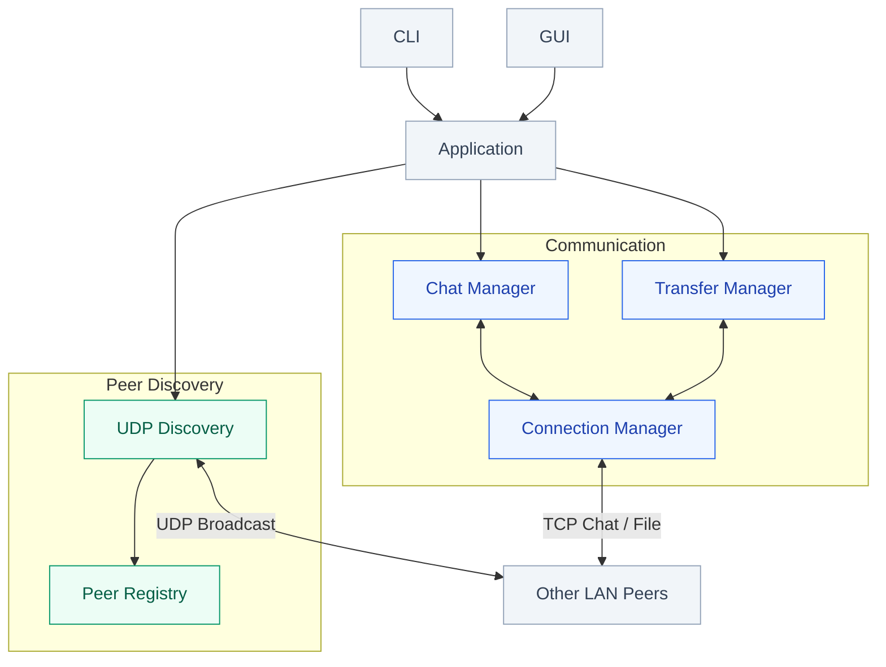

# LAN Chat & File Sharing

## 1. Giới thiệu

LAN Chat & File Sharing là chương trình nhắn tin và truyền file trực tiếp giữa các máy trong cùng mạng LAN. Mỗi phiên chạy vừa lắng nghe kết nối đến, vừa có thể chủ động kết nối tới peer khác nên không cần máy chủ trung tâm.

UDP Broadcast được dùng để các peer tự động phát hiện nhau, quảng bá trạng thái và nhận biết peer đã rời mạng. Sau khi người dùng chọn một peer, chương trình thiết lập kết nối TCP để trao đổi tin nhắn và truyền file. Ứng dụng có hai giao diện sử dụng chung phần xử lý mạng: CLI trên terminal và GUI bằng Tkinter.

## 2. Thành viên

| Thành viên | Họ và tên | MSSV |
|---|---|---|
| Member 1 | Nguyễn Trần Minh Khang | 25127369 |
| Member 2 | Nguyễn Ngọc Thanh Hương | 25127197 |
| Member 3 | Phạm Hùng Khôi | 25127390 |

## 3. Chức năng chính

- Tự động phát hiện các peer trong cùng mạng LAN bằng UDP Broadcast và Heartbeat.
- Quảng bá, cập nhật hai trạng thái `online` và `away`; loại peer khỏi danh sách sau thời gian Timeout.
- Thiết lập kết nối TCP hai chiều và quản lý đồng thời nhiều peer.
- Lưu lịch sử tin nhắn riêng theo từng peer và hiển thị số tin chưa đọc.
- Truyền file theo từng chunk, hiển thị tiến độ gửi/nhận và kiểm tra SHA-256.
- Cho phép tiếp tục nhắn tin trong lúc truyền file.
- Không ghi đè file đã có; tự tạo tên mới và xóa file tạm khi quá trình nhận bị gián đoạn.
- Cung cấp CLI giữ nguyên nội dung đang nhập khi có thông báo và GUI cập nhật qua Event Queue.
- Báo lỗi cho lệnh không hợp lệ, file không tồn tại, lỗi kết nối, dữ liệu sai protocol và ngắt kết nối.

## 4. Kiến trúc hệ thống



**Luồng UDP:** `Discovery` gửi gói presence bằng UDP Broadcast và nhận gói từ các peer khác. Thông tin hợp lệ được chuyển cho `PeerRegistry` để thêm peer mới, cập nhật trạng thái hoặc loại peer đã hết Timeout. CLI và GUI đọc snapshot từ registry để hiển thị danh sách.

**Luồng TCP:** người dùng chọn một peer đã discover; `ConnectionManager` kết nối tới IP và TCP port được quảng bá, sau đó hai bên trao đổi `HELLO` ở tầng ứng dụng để xác nhận `peer_id`. Các frame tiếp theo được chuyển đến `ChatManager` hoặc `TransferManager` theo message type.

`Application` khởi tạo các module, nối callback và điều phối vòng đời của socket, thread, CLI hoặc GUI. Mỗi phiên chạy có một `peer_id` ngẫu nhiên dùng chung cho UDP Discovery và TCP Communication.

## 5. Cấu trúc source code

```text
.
├── lanchat/
│   ├── __init__.py
│   ├── __main__.py       # Entry point và tham số dòng lệnh
│   ├── app.py            # Khởi tạo, kết nối và dừng các module
│   ├── chat.py           # Lịch sử chat và số tin chưa đọc
│   ├── cli.py            # Giao diện dòng lệnh
│   ├── config.py         # Cổng UDP, Heartbeat và Timeout mặc định
│   ├── connections.py    # Kết nối TCP với nhiều peer
│   ├── discovery.py      # UDP Broadcast, nhận presence và expiry
│   ├── gui.py            # Giao diện Tkinter
│   ├── peer_registry.py  # Danh sách peer thread-safe
│   ├── protocol.py       # Message Framing và JSON helpers
│   └── transfer.py       # Truyền file, tiến độ và SHA-256
├── tests/
│   ├── test_chat.py
│   ├── test_cli.py
│   ├── test_connections.py
│   ├── test_discovery.py
│   ├── test_gui.py
│   ├── test_integration.py
│   ├── test_protocol.py
│   └── test_transfer.py
├── .gitignore
├── pyproject.toml
├── requirements.txt
└── README.md
```

| Module | Nhiệm vụ chính |
|---|---|
| `discovery.py`, `peer_registry.py` | Phát hiện peer, theo dõi `last_seen`, trạng thái và Timeout. |
| `connections.py`, `protocol.py` | Tạo/nhận kết nối TCP, quản lý stream và đóng khung message. |
| `chat.py` | Gửi/nhận chat, lưu lịch sử và quản lý unread theo peer. |
| `transfer.py` | Gửi/nhận file theo chunk, kiểm tra kích thước và SHA-256. |
| `cli.py`, `gui.py` | Nhận thao tác người dùng và hiển thị sự kiện bất đồng bộ. |
| `app.py` | Điều phối các module và xử lý lifecycle của ứng dụng. |

## 6. Cách chương trình hoạt động

### 6.1. UDP Discovery

UDP chỉ được dùng cho discovery và presence, không dùng để truyền chat hoặc file. Mặc định, mỗi peer gửi datagram đến địa chỉ Broadcast `255.255.255.255`, cổng UDP `9999`.

| Tham số | Giá trị mặc định |
|---|---:|
| UDP port dùng chung | `9999` |
| Broadcast address | `255.255.255.255` |
| Chu kỳ Heartbeat | `3 giây` |
| Peer Timeout | `10 giây` |
| Kích thước presence tối đa | `512 byte` |

Gói presence có dạng:

```text
HELLO|name|tcp_port|status|peer_id
```

Ví dụ:

```text
HELLO|Khang|5001|online|7f43bde5957b4c93ac34d72d5cc6f477
```

`name` dài từ 1 đến 64 ký tự hợp lệ; `tcp_port` nằm trong khoảng `1–65535`; `status` chỉ nhận `online` hoặc `away`. `peer_id` là ID của phiên chạy và được dùng để bỏ qua gói của chính mình cũng như đối chiếu khi kết nối TCP. Parser vẫn nhận gói cũ gồm bốn trường không có `peer_id`, nhưng peer đó không thể dùng cho chat có kiểm tra ID.

Một gói được gửi ngay khi khởi động, sau đó lặp lại mỗi 3 giây. Khi người dùng đổi trạng thái, chương trình yêu cầu gửi lại ngay thay vì chờ Heartbeat kế tiếp. Gói nhận hợp lệ cập nhật `PeerRegistry` theo cặp `(IP, TCP port)` và thời điểm `last_seen`. Thread expiry kiểm tra mỗi 0,5 giây; peer không gửi presence trong ít nhất 10 giây bị xóa và phát sự kiện `offline`.

### 6.2. TCP Communication

TCP phù hợp với chat và truyền file vì cung cấp byte stream tin cậy, đúng thứ tự và phát hiện khi kết nối bị đóng. Mỗi peer lắng nghe TCP trên cổng đã chọn, đồng thời có thể chủ động kết nối tới peer khác.

Khi người dùng chọn peer, lời gọi `connect()` của hệ điều hành thực hiện TCP Three-Way Handshake gồm `SYN`, `SYN-ACK`, `ACK`. Sau khi kết nối TCP được thiết lập, hai ứng dụng mới trao đổi frame `HELLO` chứa `peer_id` và `name`. Bên chủ động kiểm tra ID nhận được có khớp với ID đã discover hay không; đây là kiểm tra nhất quán danh tính, không phải cơ chế xác thực hoặc mã hóa.

Mỗi kết nối có một receive worker đọc liên tục các frame đến. Chat vì vậy là hai chiều: cả hai bên đều có thể gửi bất kỳ lúc nào. `ConnectionManager` lưu các kết nối theo `peer_id`, nên một peer có thể duy trì kết nối với nhiều peer khác. Nếu hai phía cùng kết nối một lúc, chương trình dùng thứ tự từ điển của `peer_id` để hai bên cùng giữ một TCP stream và đóng stream trùng.

### 6.3. Message Framing

TCP truyền dữ liệu dưới dạng byte stream và không giữ ranh giới giữa các lần `send()`. Chương trình vì vậy thêm một header cố định trước mỗi payload. Hàm `recv_exact()` đọc đủ số byte được khai báo, kể cả khi một frame bị chia qua nhiều lần `recv()` hoặc nhiều frame đến liền nhau.

Header có kích thước 10 byte, dùng network byte order:

| Trường | Kích thước | Giá trị / ý nghĩa |
|---|---:|---|
| Magic | 4 byte | ASCII `LCHT` |
| Version | 1 byte | `1` |
| Message type | 1 byte | Loại dữ liệu trong payload |
| Payload length | 4 byte | Số byte payload, unsigned big-endian |

Payload của một frame không vượt quá `8 MiB`. Các payload có cấu trúc được mã hóa thành JSON UTF-8; riêng `FILE_CHUNK` chứa byte thô.

| Message type | Giá trị | Mục đích thực tế |
|---|---:|---|
| `HELLO` | `1` | Trao đổi `peer_id` và tên sau khi TCP kết nối. |
| `CHAT` | `2` | Gửi người gửi, nội dung và thời điểm gửi. |
| `FILE_META` | `3` | Khai báo ID, tên và kích thước file. |
| `FILE_CHUNK` | `4` | Mang một phần dữ liệu file. |
| `FILE_END` | `5` | Gửi SHA-256 hoặc ACK `status: ok`. |
| `ERROR` | `7` | Từ chối file khi kích thước/hash không hợp lệ. |

`LEAVE` có giá trị `6` trong protocol nhưng hiện không được gửi hoặc xử lý. Lệnh `/leave` chỉ bỏ chọn cuộc trò chuyện trong `ChatManager`; kết nối TCP vẫn được giữ.

### 6.4. File Transfer

Quá trình truyền file diễn ra như sau:

1. Người gửi kiểm tra đường dẫn là file thông thường và chưa có file khác đang gửi tới cùng peer.
2. Worker gửi `FILE_META` gồm `transfer_id`, tên file và kích thước.
3. File được đọc theo chunk tối đa `64 KiB`. Mỗi chunk được gửi trong một frame `FILE_CHUNK`, đồng thời người gửi cập nhật SHA-256 và tiến độ.
4. Người nhận tạo file tạm có đuôi `.part` trong `downloads/`, ghi từng chunk, đếm byte và tính SHA-256.
5. Sau chunk cuối, người gửi gửi `FILE_END` chứa digest SHA-256.
6. Người nhận so sánh số byte thực tế, kích thước đã khai báo và SHA-256. Nếu đúng, file tạm được gắn sang tên cuối rồi người nhận trả ACK `FILE_END` với `status: ok`.
7. Người gửi chỉ báo hoàn tất sau khi nhận đúng ACK; thời gian chờ ACK tối đa là 30 giây.

Nếu tên file đã tồn tại, chương trình tạo tên như `document (1).pdf` thay vì ghi đè. Tên có đường dẫn hoặc ký tự điều khiển bị từ chối. File `.part` được xóa nếu kích thước/hash sai, kết nối bị ngắt, ứng dụng dừng hoặc không thể hoàn tất file.

Mỗi peer có thể có một file đang gửi và một file đang nhận cùng lúc. Việc gửi file chạy trên worker riêng; mỗi lần gửi giữ `send_lock` cho đúng một frame. Vì vậy frame `CHAT` có thể xen giữa các `FILE_CHUNK` mà không làm trộn byte, giúp cuộc trò chuyện vẫn hoạt động trong lúc truyền file.

### 6.5. Threading và xử lý đồng thời

| Thread / nhóm thread | Nhiệm vụ |
|---|---|
| UDP broadcast worker | Gửi presence ngay khi cần và theo chu kỳ 3 giây. |
| UDP listen worker | Nhận, kiểm tra và chuyển presence vào registry. |
| UDP expiry worker | Kiểm tra peer hết Timeout mỗi 0,5 giây. |
| TCP accept worker | Chấp nhận kết nối TCP mới. |
| TCP handshake worker | Xử lý `HELLO` cho từng kết nối đến. |
| TCP receive worker | Đọc frame và chuyển đến các message handler của một kết nối. |
| File send worker | Đọc file, gửi chunk, chờ ACK mà không khóa giao diện. |
| GUI action / stop worker | Thực hiện kết nối, gửi hoặc dừng ứng dụng ngoài Tkinter main thread. |

`Lock` hoặc `RLock` bảo vệ Peer Registry, connection map, lịch sử/unread, trạng thái transfer và danh sách worker. Mỗi `PeerConnection` có `send_lock`, bảo đảm hai thread không ghi xen byte của hai frame lên cùng socket. CLI dùng output lock và `prompt_toolkit.patch_stdout()` để in thông báo rồi vẽ lại prompt cùng phần người dùng đang nhập.

Tkinter widget chỉ được cập nhật trên GUI main thread. Callback từ network thread đưa sự kiện vào `queue.Queue`; hàm `_drain()` chạy định kỳ bằng `root.after(50, ...)` để xử lý sự kiện, cập nhật danh sách peer, lịch sử chat và tiến độ.

### 6.6. Xử lý lỗi

- Presence sai định dạng, quá 512 byte, sai port hoặc sai trạng thái bị bỏ qua.
- Peer không còn gửi Heartbeat bị loại khỏi registry sau Timeout; lỗi socket UDP được chuyển thành thông báo.
- Kết nối TCP đóng hoặc frame sai protocol làm connection tương ứng bị xóa và phát thông báo ngắt kết nối.
- Lệnh CLI thiếu tham số, sai cú pháp, tên peer trùng hoặc không tìm thấy peer đều được báo mà không làm dừng chương trình.
- File không tồn tại, không phải file thông thường hoặc đã có transfer cùng chiều tới peer đó bị từ chối trước khi gửi.
- Chunk vượt kích thước đã khai báo, file thiếu byte hoặc SHA-256 không khớp làm transfer thất bại và xóa file tạm.
- Tên file nhận không an toàn bị từ chối; file có sẵn không bị ghi đè.
- Khi ứng dụng dừng, listener và các connection được đóng, transfer đang chờ được đánh thức và các worker được chờ trong thời gian giới hạn.

## 7. Cài đặt và chạy chương trình

### 7.1. Yêu cầu

- Python `3.10` trở lên, theo `pyproject.toml`.
- Dependency `prompt-toolkit==3.0.52` trong `requirements.txt`.
- Tkinter nếu chạy GUI; CLI không cần Tkinter.
- Hai máy cùng mạng IPv4 LAN để kiểm thử discovery qua Broadcast.
- Cần kết nối Internet khi máy chưa có Python hoặc khi `pip` phải tải dependency.

Giải nén file source code được cung cấp, sau đó mở Terminal, PowerShell hoặc Command Prompt tại thư mục `DoAnSocKet` chứa `README.md`. Không cần Git hoặc IDE riêng.

Trên macOS/Linux, kiểm tra Python rồi tạo và kích hoạt virtual environment:

```bash
python3 --version
python3 -m venv .venv
source .venv/bin/activate
python -m pip install -r requirements.txt
```

Trên Windows PowerShell:

```powershell
py -3 --version
py -3 -m venv .venv
.venv\Scripts\Activate.ps1
python -m pip install -r requirements.txt
```

Trên Windows Command Prompt:

```bat
py -3 --version
py -3 -m venv .venv
.venv\Scripts\activate.bat
python -m pip install -r requirements.txt
```

Kết quả kiểm tra phiên bản phải là Python 3.10 trở lên. Mỗi lần mở terminal mới, cần kích hoạt lại `.venv` trước khi chạy chương trình hoặc Unit Test.

Kiểm tra Tkinter trước khi chạy GUI:

```bash
python -m tkinter
```

Nếu một cửa sổ Tk nhỏ xuất hiện thì interpreter hiện tại đã có Tkinter. Nếu lệnh báo thiếu `_tkinter`, cần cài bản Python/Tk tương thích rồi tạo lại virtual environment bằng interpreter đó.

### 7.2. Chạy trên hai máy

Các lệnh dưới đây được nhập trong terminal của hệ điều hành sau khi kích hoạt `.venv`. Hai máy phải kết nối cùng mạng LAN và dùng chung UDP port; tên và TCP port nên khác nhau. UDP Discovery tự tìm peer nên trong điều kiện mạng bình thường người dùng không cần nhập địa chỉ IP.

**Computer A — Khang, TCP port 5001:**

```bash
python -m lanchat --name Khang --port 5001
```

**Computer B — Huong, TCP port 5002:**

```bash
python -m lanchat --name Huong --port 5002
```

Chạy GUI bằng cách thêm `--gui`:

```bash
# Computer A
python -m lanchat --gui --name Khang --port 5001

# Computer B
python -m lanchat --gui --name Huong --port 5002
```

Cổng UDP mặc định là `9999`. Nếu đổi cổng, mọi peer phải dùng cùng giá trị:

```bash
python -m lanchat --name Khang --port 5001 --udp-port 23001
```

Tham số `--port 0` cho phép hệ điều hành chọn một TCP port còn trống; ứng dụng sẽ in và quảng bá cổng thực tế. Firewall cần cho phép UDP vào cổng discovery và TCP vào cổng của từng peer. Guest Wi-Fi, VPN hoặc network isolation có thể chặn Broadcast. Cần đóng phiên bản đang chạy trước khi khởi động phiên bản khác sử dụng cùng TCP port.

## 8. Hướng dẫn sử dụng

### 8.1. CLI

Sau khi chạy lệnh terminal `python -m lanchat ...`, nhập các lệnh sau tại prompt `> ` bên trong chương trình:

| Lệnh / cú pháp | Chức năng |
|---|---|
| `/list` | Liệt kê peer đã discover cùng IP, TCP port và trạng thái. |
| `/chat <name\|number>` | Chọn peer theo tên duy nhất hoặc số thứ tự trong `/list`; kết nối nếu cần. |
| `<nội dung tin nhắn>` | Gửi dòng không bắt đầu bằng `/` tới peer đang chọn. |
| `/send <đường dẫn file>` | Gửi file tới peer đang chọn; toàn bộ phần sau `/send ` là đường dẫn. |
| `/leave` | Bỏ chọn cuộc trò chuyện hiện tại nhưng giữ các kết nối TCP. |
| `/status online` | Chuyển trạng thái sang `online` và quảng bá ngay. |
| `/status away` | Chuyển trạng thái sang `away` và quảng bá ngay. |
| `/help` | Hiển thị danh sách lệnh ngắn gọn. |
| `/quit` | Dừng các module mạng và thoát chương trình. |

### 8.2. GUI

- Chọn một peer trong danh sách bên trái để kết nối và mở lịch sử chat.
- Nhập tin nhắn rồi nhấn Enter hoặc nút **Send**.
- Chọn `online` hoặc `away` trong hộp trạng thái ở góc trên.
- Nhấn **Send file…** để chọn file. Thanh phía dưới hiển thị tiến độ; vùng thông báo cho biết thành công hoặc lỗi.
- Cột **Unread** hiển thị số tin chưa đọc; peer hết Timeout vẫn được giữ trong danh sách GUI với trạng thái `offline` để người dùng xem lại lịch sử trong phiên hiện tại.

File nhận được lưu trong thư mục `downloads/` tính từ thư mục đang chạy chương trình. Ví dụ, nếu chạy ở thư mục gốc repository thì file nằm tại `DoAnSocKet/downloads/`.

## 9. Kiểm thử và demo

### 9.1. Automated testing

Từ thư mục chứa `README.md`, với virtual environment đã kích hoạt:

```bash
python -m unittest discover -s tests -p 'test_*.py' -v
```

Test suite kiểm tra protocol framing, UDP lifecycle, trạng thái peer, TCP nhiều kết nối, chat/unread, CLI, GUI event handling, file transfer/cleanup và tích hợp TCP loopback. Lần chạy ngày 26/11/2026 đạt **40/40 test, 0 lỗi, 0 skip** trong 27,468 giây. Automated test trên loopback không thay thế kiểm thử hai laptop thật.

### 9.2. Kiểm thử thủ công trên hai máy

1. **Peer Discovery:** chạy Khang và Huong trên hai laptop cùng LAN; dùng `/list` và kiểm tra đúng tên, IP, port.
2. **Online/Away:** đổi `/status away`, sau đó trở lại `/status online`; quan sát máy còn lại cập nhật mà không cần khởi động lại.
3. **TCP Chat:** chọn peer bằng `/chat`, gửi Unicode và trao đổi hai chiều. Nếu có peer thứ ba, gửi tin khi cuộc trò chuyện đó chưa được chọn để kiểm tra unread.
4. **File Transfer:** gửi file nhỏ và file lớn hơn 64 KiB, theo dõi tiến độ ở cả hai bên và kiểm tra file trong `downloads/`.
5. **Concurrent Chat:** trong lúc file lớn đang truyền, tiếp tục gửi tin nhắn theo cả hai chiều.
6. **SHA-256 Verification:** so sánh hash của file gốc và file đã nhận.

Trên macOS/Linux:

```bash
shasum -a 256 path/to/source-file
shasum -a 256 downloads/received-file
```

Trên Windows PowerShell:

```powershell
Get-FileHash path\to\source-file -Algorithm SHA256
Get-FileHash downloads\received-file -Algorithm SHA256
```

Hai chuỗi hash phải giống nhau. Đây là bước kiểm tra độc lập ngoài cơ chế SHA-256 nội bộ của chương trình.

### 9.3. Kiểm tra bằng Wireshark

Chọn interface Wi-Fi hoặc Ethernet đang nối LAN và bắt gói trước khi khởi động ứng dụng.

**UDP Broadcast và Heartbeat:**

```text
udp.port == 9999
```

Quan sát destination là địa chỉ Broadcast, payload bắt đầu bằng `HELLO|`, và các gói cùng peer xuất hiện khoảng mỗi 3 giây. Nếu dùng `--udp-port` khác, thay `9999` bằng cổng thực tế.

**TCP Three-Way Handshake:**

```text
tcp.port == 5001 || tcp.port == 5002
```

Đóng kết nối cũ hoặc khởi động lại peer, bắt đầu capture rồi chọn peer để tạo kết nối mới. Theo dõi một TCP stream và tìm ba packet `SYN`, `SYN-ACK`, `ACK` trước các frame ứng dụng. Có thể thu hẹp các packet bắt tay bằng:

```text
(tcp.port == 5001 || tcp.port == 5002) && tcp.flags.syn == 1
```

Sau handshake, kiểm tra cùng TCP stream có dữ liệu ứng dụng; Wireshark sẽ hiển thị payload TCP chứ không tự giải mã protocol `LCHT`. Không dùng ảnh hoặc kết quả capture giả; kiểm thử Wireshark cần thực hiện trên môi trường demo thật.

## 10. Một số lỗi thường gặp

| Hiện tượng | Nguyên nhân thường gặp và cách kiểm tra |
|---|---|
| Hai máy không phát hiện nhau | Kiểm tra cùng mạng IPv4 LAN, cùng UDP port, firewall cho phép UDP, không dùng guest Wi-Fi/client isolation; VPN có thể chặn Broadcast. Chờ ít nhất một chu kỳ Heartbeat. |
| Không kết nối được TCP | Kiểm tra peer còn trong `/list`, đúng TCP port, firewall cho phép inbound TCP và không có tiến trình khác chiếm cổng. Entry cũ có thể còn tối đa khoảng 10 giây. |
| Thiếu dependency hoặc sai environment | Kích hoạt đúng `.venv`, kiểm tra `python --version`, rồi chạy lại `python -m pip install -r requirements.txt`. |
| Không mở được GUI Tkinter | Chạy `python -m tkinter`. Nếu thiếu `_tkinter`, dùng CLI hoặc cài Python/Tk tương thích và tạo lại `.venv`. |
